<picture>
  <source media="(prefers-color-scheme: dark)" srcset="./dark_mode.svg">
  
</picture>

<h3 align="center">Guestbook</h3>

  

<!-- guestbook:start -->

<table align="center">
  <tr>
    <td></td>
    <td><a href="https://github.com/M0ntti"><b>@M0ntti</b></a></td>
    <td>passed by and left a star</td>
    <td>2026-10-20 · 09:07</td>
  </tr>
  <tr>
    <td></td>
    <td><a href="https://github.com/LelouchC21440"><b>@LelouchC21440</b></a></td>
    <td>se eu não gosto do lado A e do aldo B por que não posso exercer o meu direto de não optar por ninguém?</td>
    <td>2026-10-20 · 09:05</td>
  </tr>
  <tr>
    <td></td>
    <td><a href="https://github.com/CaioSouza07"><b>@CaioSouza07</b></a></td>
    <td><i>passed by and left a star</i></td>
    <td>2026-10-20 · 08:28</td>
  </tr>
  <tr>
    <td></td>
    <td><a href="https://github.com/CaioSouza07"><b>@CaioSouza07</b></a></td>
    <td>No hablo macaco</td>
    <td>2026-10-20 · 08:28</td>
  </tr>
  <tr>
    <td></td>
    <td><a href="https://github.com/Shuraza"><b>@Shuraza</b></a></td>
    <td><i>passed by and left a star</i></td>
    <td>2026-10-20 · 08:19</td>
  </tr>
  <tr>
    <td></td>
    <td><a href="https://github.com/CaioSouza07"><b>@CaioSouza07</b></a></td>
    <td>Algo aí kkkkkj</td>
    <td>2026-10-20 · 08:17</td>
  </tr>
</table>

<!-- guestbook:end -->

  &nbsp;
  

  

